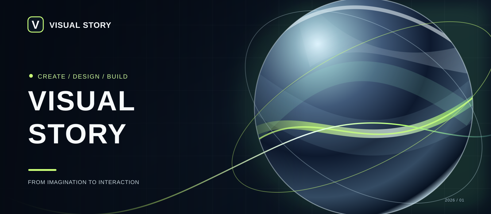
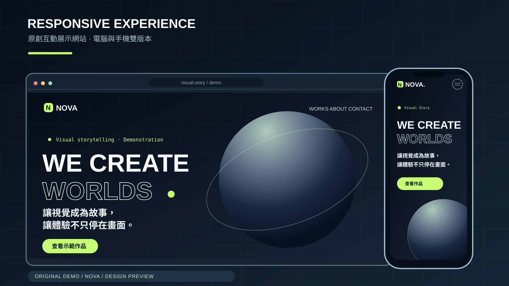

<!-- Visual Story · en · Community v1.1.0 -->
<div align="center">
<a href="community/SKILL.md"></a>
<br/><br/>
<a href="community/SKILL.md"></a>
<a href="community/README.md"></a>
<a href="docs/VERIFICATION.md"></a>
<a href="docs/LICENSING.md"></a>
<br/>


<br/><br/>
<p align="center"><strong>English</strong> · <a href="README.zh-CN.md">简体中文</a> · <a href="README.zh-TW.md">繁體中文</a></p>

<h3>Visual assets to interactive websites</h3>

Visual Story turns supplied characters, product imagery, moodboards and brand assets into a repeatable **Agent Skill** workflow for responsive, motion-aware websites. **Community is a functional demo, not a deployed SaaS or automatic AI image generator.**

[Agent Skill](community/SKILL.md) · [Source Demo](community/assets/starter-site/index.html) · [Installation](community/README.md) · [Verification](docs/VERIFICATION.md)
</div>

---

## ✦ Showcase — Original Demo

<p align="center"></p>

> This is an **original NOVA starter concept**, not a client case study and not a reproduction of the reference video. The visual is a design illustration rather than a screenshot of a published live site. The demo can be opened locally with `index.html`.

## ✦ What Community Includes

| Module | Available implementation |
| --- | --- |
| **Visual direction** | Character/brand consistency and design guidelines |
| **Scene & motion** | Story structure, animation rules and mobile fallbacks |
| **Responsive demo** | Working HTML/CSS/JavaScript with mobile navigation and project filters |
| **Asset manifest** | File metadata, paths and SHA-256 inventory |
| **Checks** | Static site validation and Python regression tests |

**Not included:** paid AI image/video generation, hosted one-click deployment, Pro membership or payment/license-key management.

## ✦ Get Started in 3 Steps

**1. Download the repository** (or select **Code → Download ZIP** on GitHub):

```bash
git clone https://github.com/Allen-Zhi-Ming/Visual-Story.git
cd Visual-Story
```

**2. Install the Community skill.** Copy the entire `community/` folder into your Codex skills directory and name it `visual-story-site`:

| OS | Directory |
| --- | --- |
| Windows | `%USERPROFILE%\.codex\skills\visual-story-site` |
| macOS / Linux | `${CODEX_HOME:-$HOME/.codex}/skills/visual-story-site` |

Windows setup details: [`community/install/INSTALL.en.md`](community/install/INSTALL.en.md). Set the skills path relative to your custom `CODEX_HOME` if configured.

**3. In Codex, try:**

```text
Use $visual-story-site to build a responsive, mobile-first interactive site from my characters and brand assets. Keep original materials intact and report test evidence and any missing pieces.
```

## ✦ Language settings

**GitHub:** this `README.md` is English by default. Use the language links above to open Simplified or Traditional Chinese documentation. GitHub README pages cannot run interactive JavaScript toggles. **Demo website:** select English, 简体中文 or 繁體中文 from the top navigation. First visits default to English; a selected language is saved when the browser allows local storage. `?lang=zh-CN` or `?lang=zh-TW` overrides the selection for the current visit.

<details>
<summary><b>🧪 Developer Checks</b></summary>

```bash
python community/scripts/test_skill.py
python community/scripts/check_site.py --site community/assets/starter-site --strict
python community/scripts/asset_manifest.py scan --input YOUR_MEDIA_DIRECTORY --output asset-manifest.json
```

Static checks are **not** a substitute for actual cross-browser deployment testing. See the verification record.

</details>

## ✦ Repository Structure

```text
Visual-Story/
├── README.md / README.zh-CN.md / README.zh-TW.md
├── docs/
│   ├── media/                       (original visual assets)
│   ├── LICENSING*.md                (license status)
│   └── VERIFICATION*.md             (evidence)
└── community/
    ├── SKILL.md                    (English default)
    ├── SKILL.zh-CN.md / SKILL.zh-TW.md
    ├── assets/starter-site/        (HTML / CSS / JS / i18n)
    ├── references/                 (design and implementation)
    ├── scripts/                    (checks and asset inventory)
    └── install/                    (Windows guide and scripts)
```

## ✦ Verification Status

| Check | Status | Evidence scope |
| --- | --- | --- |
| Python regression | **4/4 PASS** | Baseline checks, not live CI |
| Static site | **PASS** | Zero errors or warnings in baseline |
| JavaScript syntax | **PASS** | `node --check` baseline |
| Mobile/desktop behavior | **PASS (limited simulation)** | 320/390/768/1440 px baseline |
| i18n source tests | **4/4 PASS** | English default, three locales, valid links |
| Real URL browser load | **BLOCKED in baseline** | Environment restriction, not marked PASS |
| Windows installation / live hosting | **NOT_RUN** | Not claimed as delivered |


[Full evidence record](docs/VERIFICATION.md)

## ✦ Licensing & Commercial Plans

Visual Story Community is a **public source-available preview**, not currently released under MIT, Apache or GPL. Public visibility **does not grant a separate commercial redistribution license**. Pro functionality and payment systems are **not implemented**. Read the [license status](docs/LICENSING.md) before reuse or redistribution.

## ✦ Original Artwork & Attribution

The workflow was independently implemented from high-level ideas demonstrated in a reference video. No third-party characters, footage or protected artwork from that video are bundled. Do not present the demo concepts as customer work.

---

<div align="center">
<b>VISUAL STORY</b> · <i>From imagination to interaction.</i>
<br/><sub>Build visuals. Tell stories. Ship real interfaces.</sub>
</div>

## Three interactive showcases · P1

These are **original, fictional, functioning concept pages**, not client projects, AI-generated product photos or real stores. Each has an English-default interface with Simplified and Traditional Chinese choices.

| Demonstration | Interaction | Source |
| --- | --- | --- |
| [ECHO — Character Portfolio](community/assets/starter-site/showcase/character.html) | Scene + pose switching | Self-contained vector concept |
| [VALE — Brand Experience](community/assets/starter-site/showcase/brand.html) | Three editorial collection states | CSS design object |
| [AURA — Product Showcase](community/assets/starter-site/showcase/product.html) | Color, size, quantity + local demo bag | Original SVG jacket; **no checkout** |

## Deployment and quality gates · P0/P2

- [Vercel deployment](https://visual-story-six.vercel.app/) — Git-connected static site (live reachability must be verified independently).
- [Automated quality workflow](.github/workflows/quality.yml) — runs on pull requests and pushes to `main`.
- [Browser tests](tests/browser_smoke.py) — responsive 320/390/768/1440 px, three locales, page transitions and interactions.
- [Static integrity tests](tests/static_integrity.py) — asset references, no dead links, translation keys and pages.
- [Release checklist](docs/RELEASE-GATES.md) — what is and is not enforced by GitHub/Vercel.

