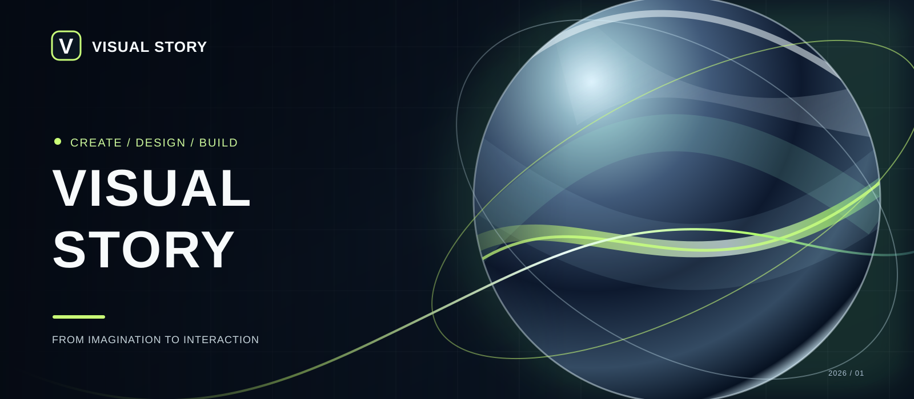
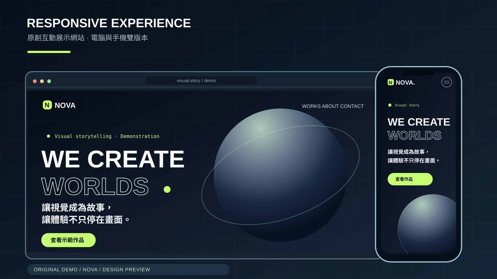

<!-- Visual Story · zh-CN · Community v1.1.0 -->
<div align="center">
<a href="community/SKILL.md"></a>
<br/><br/>
<a href="community/SKILL.md"></a>
<a href="community/README.md"></a>
<a href="docs/VERIFICATION.zh-CN.md"></a>
<a href="docs/LICENSING.md"></a>
<br/>


<br/><br/>
<p align="center"><a href="README.md">English</a> · <strong>简体中文</strong> · <a href="README.zh-TW.md">繁體中文</a></p>

<h3>从视觉素材到交互网站</h3>

Visual Story 将角色、商品图片、视觉参考和品牌素材整理成可重复使用的 **Agent Skill** 流程，用于制作兼容手机与电脑的交互网站。**Community 是可运行的演示，并非已上线的 SaaS 或自动 AI 生图工具。**

[Agent Skill](community/SKILL.md) · [Source Demo](community/assets/starter-site/index.html) · [Installation](community/README.md) · [Verification](docs/VERIFICATION.zh-CN.md)
</div>

---

## ✦ 作品预览 — 原创演示

<p align="center"></p>

> 这是 **NOVA 原创演示网站**，并非客户案例，也不是参考视频中网站的复制品。图片属于版式示意，并非已发布网站的浏览器截图；下载后可直接打开 `index.html`。

## ✦ Community 已提供的功能

| 模块 | 当前提供 |
| --- | --- |
| **视觉规划** | 角色与品牌一致性、设计规范 |
| **场景与动态** | 叙事规划、动效规范、移动端降级 |
| **响应式演示** | 可运行的 HTML/CSS/JavaScript、移动端导航及作品筛选 |
| **素材盘点** | 文件信息、路径与 SHA-256 清单 |
| **质量检查** | 静态网页检查及 Python 回归测试 |

**尚未提供：** 付费 AI 图片／视频生成、远程一键部署、Pro 会员或付款／授权码管理。

## ✦ 三步开始

**1. 下载源代码**（或在 GitHub 点击 **Code → Download ZIP**）：

```bash
git clone https://github.com/Allen-Zhi-Ming/Visual-Story.git
cd Visual-Story
```

**2. 安装 Community 技能。** 将整个 `community/` 文件夹复制到 Codex 的 skills 目录，并命名为 `visual-story-site`：

| OS | Directory |
| --- | --- |
| Windows | `%USERPROFILE%\.codex\skills\visual-story-site` |
| macOS / Linux | `${CODEX_HOME:-$HOME/.codex}/skills/visual-story-site` |

Windows 安装说明：[`community/install/INSTALL.zh-CN.md`](community/install/INSTALL.zh-CN.md)。如已自定义 `CODEX_HOME`，请使用其中的 `skills` 目录。

**3. 在 Codex 输入：**

```text
使用 $visual-story-site，根据我提供的角色、图片及品牌素材，制作移动端优先且兼容电脑的交互展示网站。保留原始素材，并附上测试证据和未完成事项。
```

## ✦ 语言设置

**GitHub：** 默认首页 `README.md` 为英文，点击顶部链接可切换简体或繁体说明。GitHub README 无法执行 JavaScript 即时切换。**演示网站：** 顶部可选择 English、简体中文、繁體中文。首次访问默认英文；浏览器允许时会保存语言选择。使用 `?lang=zh-CN` 或 `?lang=zh-TW` 可临时指定语言。

<details>
<summary><b>🧪 开发验收</b></summary>

```bash
python community/scripts/test_skill.py
python community/scripts/check_site.py --site community/assets/starter-site --strict
python community/scripts/asset_manifest.py scan --input YOUR_MEDIA_DIRECTORY --output asset-manifest.json
```

静态检查**不能替代**正式部署与跨浏览器验收，详见验证记录。

</details>

## ✦ 项目结构

```text
Visual-Story/
├── README.md / README.zh-CN.md / README.zh-TW.md
├── docs/
│   ├── media/                       (original visual assets)
│   ├── LICENSING*.md                (license status)
│   └── VERIFICATION*.md             (evidence)
└── community/
    ├── SKILL.md                    (English default)
    ├── SKILL.zh-CN.md / SKILL.zh-TW.md
    ├── assets/starter-site/        (HTML / CSS / JS / i18n)
    ├── references/                 (design and implementation)
    ├── scripts/                    (checks and asset inventory)
    └── install/                    (Windows guide and scripts)
```

## ✦ 验证状态

| 检查 | 状态 | 范围 |
| --- | --- | --- |
| Python 回归测试 | **4/4 PASS** | 基线检查，并非实时 CI |
| 静态网站 | **PASS** | 基线 0 错误、0 警告 |
| JavaScript 语法 | **PASS** | 基线 `node --check` |
| 手机／电脑端 | **PASS（有限模拟）** | 基线 320/390/768/1440 px |
| 多语言检查 | **4/4 PASS** | 默认英文、三语文档、链接有效 |
| 真实 URL 加载 | **基线 BLOCKED** | 环境限制，未标记通过 |
| Windows 安装／正式部署 | **NOT_RUN** | 不宣称已完成 |


[Full evidence record](docs/VERIFICATION.zh-CN.md)

## ✦ 授权与商业规划

Visual Story Community 是 **source-available 公开预览版**，目前未采用 MIT、Apache 或 GPL。源代码公开**不代表已授予商业再分发授权**。Pro 功能及付费系统**尚未实现**。使用或再分发前请阅读[授权说明](docs/LICENSING.zh-CN.md)。

## ✦ 原创素材与来源

本技能根据参考视频展示的一般流程概念，独立开发原创工具与演示。未包含原作者的角色、片段或受保护视觉素材，也不会将概念作品描述为客户案例。

---

<div align="center">
<b>VISUAL STORY</b> · <i>From imagination to interaction.</i>
<br/><sub>让视觉讲故事，交付真正可用的界面。</sub>
</div>

## 三个交互示例与质量检查 · P0–P2

ECHO 角色作品集支持场景及姿势切换；VALE 品牌形象可切换系列；AURA 商品展示可选择颜色、尺码、数量与演示购物袋（不支持付款及发货）。三个示例均为原创虚构展示，默认英文并支持简体／繁体。

- [ECHO — Character](community/assets/starter-site/showcase/character.html)
- [VALE — Brand](community/assets/starter-site/showcase/brand.html)
- [AURA — Product](community/assets/starter-site/showcase/product.html)
- [Vercel 展示网址](https://visual-story-six.vercel.app/)
- [自动测试流程](.github/workflows/quality.yml)
- [验收与发布规则](docs/RELEASE-GATES.md)

