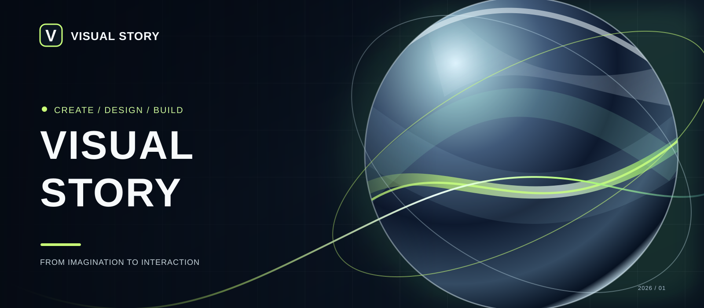

<!-- Visual Story · zh-TW · Community v1.3.0 -->
<div align="center">
<a href="community/SKILL.md"></a>
<br/><br/>
<a href="community/SKILL.md"></a>
<a href="community/README.md"></a>
<a href="docs/VERIFICATION.zh-TW.md"></a>
<a href="docs/LICENSING.md"></a>
<br/>


<br/><br/>
<p align="center"><a href="README.md">English</a> · <a href="README.zh-CN.md">简体中文</a> · <strong>繁體中文</strong></p>

<h3>從視覺素材到互動網站</h3>

Visual Story 將角色、商品圖片、視覺參考及品牌素材，整理成可重複使用的 **Agent Skill** 流程，協助製作具互動效果、支援手機與電腦的網站。**Community 是可運作的示範，不是已上線的 SaaS 或自動 AI 生圖器。**

[Agent Skill](community/SKILL.md) · [Source Demo](community/assets/starter-site/index.html) · [Installation](community/README.md) · [Verification](docs/VERIFICATION.zh-TW.md)
</div>

---

## ✦ 線上展示 — v1.3.0

三個以不同設計語言製作的原創概念案例，已發布到 Vercel：

<table><tr>
<td width="33%" align="center"><a href="https://visual-story-six.vercel.app/showcase/character.html"></a><br/><b><a href="https://visual-story-six.vercel.app/showcase/character.html">ECHO · 角色</a></b><br/><sub>時尚攝影排版與取景切換</sub></td>
<td width="33%" align="center"><a href="https://visual-story-six.vercel.app/showcase/brand.html"></a><br/><b><a href="https://visual-story-six.vercel.app/showcase/brand.html">VALE · 品牌</a></b><br/><sub>精品編輯排版與系列主題</sub></td>
<td width="33%" align="center"><a href="https://visual-story-six.vercel.app/showcase/product.html"></a><br/><b><a href="https://visual-story-six.vercel.app/showcase/product.html">AURA · 商品</a></b><br/><sub>概念商品介面與示範購物袋</sub></td>
</tr></table>

> 圖片、人物與商品均屬**虛構 AI 概念素材**；切換顏色與取景不等於產生真實商品，也沒有實際結帳、出貨或經驗證的庫存。[素材來源與限制](docs/VISUAL-PROVENANCE.md)。


## ✦ Community 已提供的功能

| 模組 | 目前提供 |
| --- | --- |
| **視覺規劃** | 角色與品牌一致性、設計規範 |
| **場景與動態** | 敘事規劃、動效規則、手機降級 |
| **響應式展示** | 可運作 HTML/CSS/JavaScript、手機導覽及作品分類 |
| **素材盤點** | 檔案資訊、路徑與 SHA-256 清單 |
| **品質檢查** | 靜態網頁檢查與 Python 回歸測試 |

**尚未提供：** 付費 AI 圖片／影片生成、遠端一鍵部署、Pro 會員或付款／授權碼管理。

## ✦ 三步驟開始

**1. 下載原始碼**（或在 GitHub 使用 **Code → Download ZIP**）：

```bash
git clone https://github.com/Allen-Zhi-Ming/Visual-Story.git
cd Visual-Story
```

**2. 安裝 Community 技能。** 將整個 `community/` 資料夾複製到 Codex 的 skills 目錄，命名為 `visual-story-site`：

| OS | Directory |
| --- | --- |
| Windows | `%USERPROFILE%\.codex\skills\visual-story-site` |
| macOS / Linux | `${CODEX_HOME:-$HOME/.codex}/skills/visual-story-site` |

Windows 安裝方式：[`community/install/安裝說明.txt`](community/install/%E5%AE%89%E8%A3%9D%E8%AA%AA%E6%98%8E.txt)。若自訂 `CODEX_HOME`，請使用其下的 `skills` 資料夾。

**3. 在 Codex 輸入：**

```text
使用 $visual-story-site，依我提供的角色、圖片和品牌素材，製作手機優先且支援電腦的互動展示網站。保留原始素材，並附上測試證據與未完成項目。
```

## ✦ 語言設定

**GitHub：** 預設首頁 `README.md` 是英文，使用上方連結可切換簡體或繁體文件。GitHub README 無法執行 JavaScript 即時切換。**示範網站：** 頂部可選 English、简体中文、繁體中文。第一次開啟預設英文；瀏覽器允許時會保存語言選擇。網址加上 `?lang=zh-CN` 或 `?lang=zh-TW` 可暫時指定語言。

<details>
<summary><b>🧪 開發驗收</b></summary>

```bash
python community/scripts/test_skill.py
python community/scripts/check_site.py --site community/assets/starter-site --strict
python community/scripts/asset_manifest.py scan --input YOUR_MEDIA_DIRECTORY --output asset-manifest.json
```

靜態檢查**不能取代**正式部署與跨瀏覽器驗收，詳見驗收紀錄。

</details>

## ✦ 專案結構

```text
Visual-Story/
├── README.md / README.zh-CN.md / README.zh-TW.md
├── docs/
│   ├── media/                       (original visual assets)
│   ├── LICENSING*.md                (license status)
│   └── VERIFICATION*.md             (evidence)
└── community/
    ├── SKILL.md                    (English default)
    ├── SKILL.zh-CN.md / SKILL.zh-TW.md
    ├── assets/starter-site/        (HTML / CSS / JS / i18n)
    ├── references/                 (design and implementation)
    ├── scripts/                    (checks and asset inventory)
    └── install/                    (Windows guide and scripts)
```

## ✦ 驗收狀態

| 檢查 | 狀態 | 範圍 |
| --- | --- | --- |
| Python 回歸測試 | **4/4 PASS** | 基線檢查，非即時 CI |
| 靜態網站 | **PASS** | 基線 0 錯誤、0 警告 |
| JavaScript 語法 | **PASS** | 基線 `node --check` |
| 手機／電腦版 | **PASS（受限模擬）** | 基線 320/390/768/1440 px |
| 多語系檢查 | **4/4 PASS** | 預設英文、三語文件、連結有效 |
| 真實 URL 載入 | **基線 BLOCKED** | 環境限制，未標為通過 |
| Windows 安裝 | **NOT_RUN** | 不宣稱已完成 |


[Full evidence record](docs/VERIFICATION.zh-TW.md)

## ✦ 授權與商業規劃

Visual Story Community 是 **source-available 公開預覽**，尚未套用 MIT、Apache 或 GPL。程式碼公開**不表示已授予商業再散布授權**。Pro 功能與付款系統**尚未實作**。使用或再散布前請閱讀[授權說明](docs/LICENSING.zh-TW.md)。

## ✦ 原創素材與來源

本技能根據參考影片展示的一般流程概念，獨立製作原創工具及示範。未納入影片原作者的角色、片段或受保護視覺素材，也不將概念作品冒充客戶案例。

---

<div align="center">
<b>VISUAL STORY</b> · <i>From imagination to interaction.</i>
<br/><sub>讓視覺說故事，交付真正可用的介面。</sub>
</div>

## 三個互動示範與品質檢查 · P0–P2

ECHO 角色作品集可切換場景氛圍與取景；VALE 品牌形象可切換系列；AURA 商品展示可選擇顏色、尺寸、數量與示範購物袋（不含付款及出貨）。三個案例皆為原創虛構展示，英文預設並支援簡體／繁體。

- [ECHO — Character](community/assets/starter-site/showcase/character.html)
- [VALE — Brand](community/assets/starter-site/showcase/brand.html)
- [AURA — Product](community/assets/starter-site/showcase/product.html)
- [Vercel 展示网址](https://visual-story-six.vercel.app/)
- [自动测试流程](.github/workflows/quality.yml)
- [验收与发布规则](docs/RELEASE-GATES.md)

